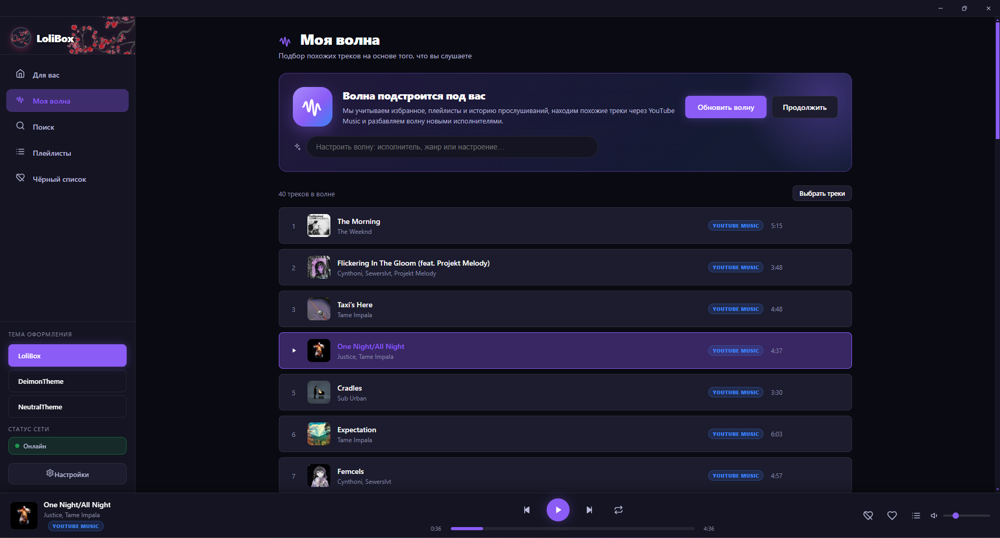
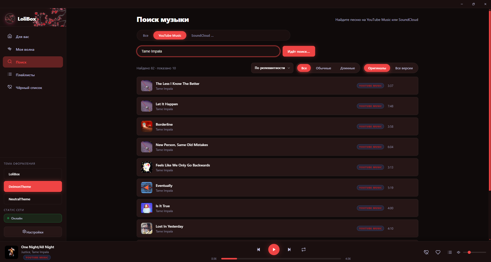
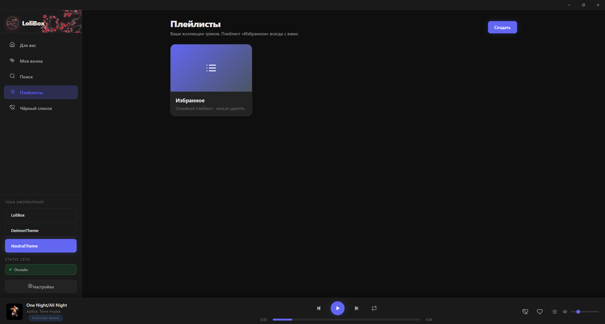
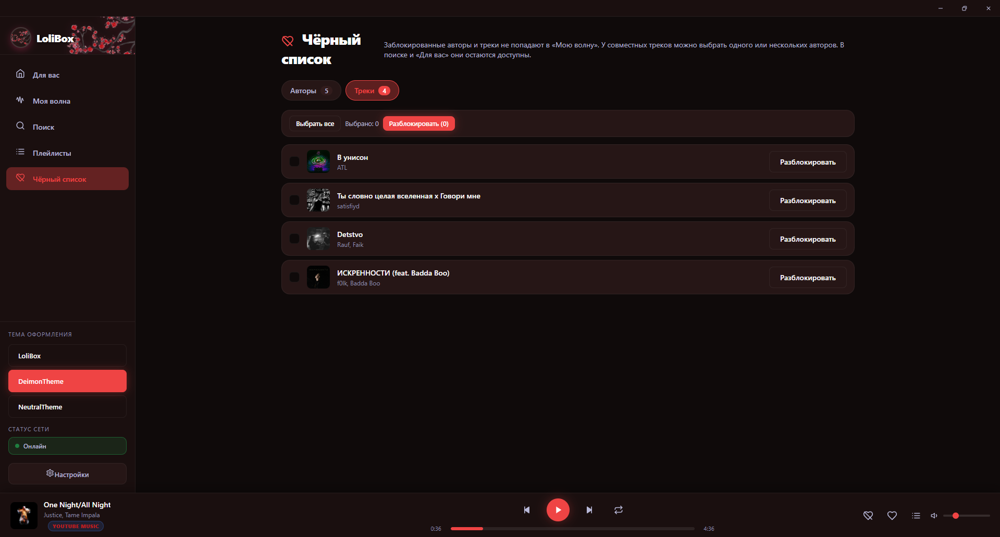
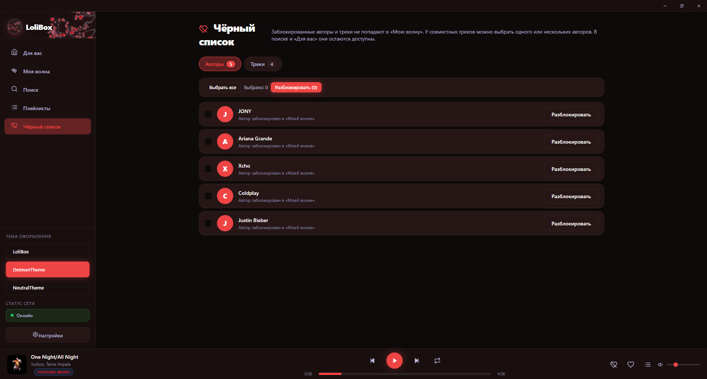
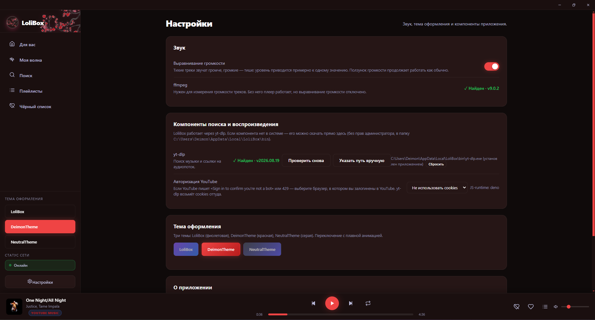

# LoliBox

**LoliBox** — лёгкий десктопный музыкальный плеер для Windows, который ищет и играет музыку из **YouTube Music** и **SoundCloud** через [yt-dlp](https://github.com/yt-dlp/yt-dlp). Без подписок, рекламы и браузера: только ваша библиотека, плейлисты и персональная «Волна».

<p>
  
  
  
  
</p>



## Возможности

- **Поиск по YouTube Music и SoundCloud** — тысячи треков, фильтры по длине и версиям, быстрый предпросмотр.
- **«Моя волна»** — персональная подборка похожих треков на основе избранного, плейлистов и истории прослушиваний.
- **Библиотека и плейлисты** — избранное, собственные коллекции, жанры и быстрый доступ к любимым исполнителям.
- **Выравнивание громкости** — тихие треки звучат громче, громкие — тише, без ручной подстройки.
- **Кастомный трей** — обложка, прогресс, play/pause, переключение треков, избранное и живая регулировка громкости прямо из системного трея.
- **Три темы оформления** — LoliBox, Deimon Theme и NeutralTheme.
- **Чёрный список** — скрывайте нежелательных исполнителей и треки из рекомендаций.
- **Автоустановка компонентов** — yt-dlp и ffmpeg можно скачать прямо из настроек приложения.

<p>
  
  
</p>
<p>
  
  
</p>
<p>
  
</p>

## Установка

1. Скачайте последний установщик со страницы [Releases](https://github.com/Deirmos/LoliBox/releases/latest):

   **`LoliBox-Setup-x.y.z.exe`**

2. Запустите его и следуйте инструкциям. Установка не требует прав администратора.
3. При первом запуске откройте **Настройки** и установите недостающие компоненты (**yt-dlp** и **ffmpeg**), если они ещё не найдены в системе.

> Приложение распространяется как есть и не содержит музыки. Все треки воспроизводятся из открытых источников.

## Сборка из исходников

### Требования

- Windows 10/11 (x64)
- [Node.js](https://nodejs.org/) 18 или новее
- npm

### Разработка

```bash
git clone https://github.com/Deirmos/LoliBox.git
cd LoliBox
npm install
npm run dev
```

`npm run dev` запускает Vite и Electron с горячей перезагрузкой интерфейса.

### Сборка установщика

```bash
npm run dist
```

Готовый файл появится в `release/LoliBox-Setup-<version>.exe`.

Другие полезные команды:

| Команда | Что делает |
| --- | --- |
| `npm run build` | Собирает renderer в `dist/` |
| `npm start` | Запускает Electron без dev-сервера |
| `npm run pack` | Собирает распакованную версию в `release/win-unpacked` |
| `npm run dist:portable` | Собирает portable-версию |
| `npm run dist:all` | Собирает установщик и portable-версию |

## Как это работает

LoliBox состоит из двух частей:

- **main process** (Electron + Node.js) — окно, трей, база настроек и библиотеки, вызовы `yt-dlp` и `ffmpeg`, кэш прямых ссылок на аудиопоток;
- **renderer** (React + Vite) — интерфейс плеера, поиск, плейлисты и рекомендации.

Данные пользователя хранятся локально:

```
%APPDATA%\LoliBox\lolibox.json   — библиотека, плейлисты, настройки, история
%APPDATA%\LoliBox\cache.json     — кэш ссылок и обложек
```

Прямые ссылки на поток кэшируются, а при ошибке воспроизведения запрашиваются заново — поэтому просроченная ссылка YouTube не требует перезапуска трека.

## Частые вопросы

**Треки не загружаются, хотя интернет работает.**
Проверьте, что установлены `yt-dlp` и `ffmpeg` (Настройки → Компоненты поиска и воспроизведения). Если вы используете VPN, убедитесь, что он корректно работает с IPv6: некоторые VPN-конфигурации с принудительным IPv4 ломают загрузку потока.

**YouTube просит подтвердить, что вы не бот.**
Выберите в настройках браузер, в котором вы авторизованы в YouTube — yt-dlp возьмёт cookies оттуда.

**Где хранится моя музыка?**
Музыка не скачивается: приложение хранит только метаданные, плейлисты и кэш ссылок. Сами треки воспроизводятся из сети.

## Лицензия

Проект распространяется по лицензии **GNU General Public License v3.0**. Подробности — в файле [LICENSE](LICENSE).

LoliBox не связан с YouTube, Google или SoundCloud. Все товарные знаки принадлежат их владельцам. Пожалуйста, соблюдайте условия использования сервисов и права авторов музыки.
